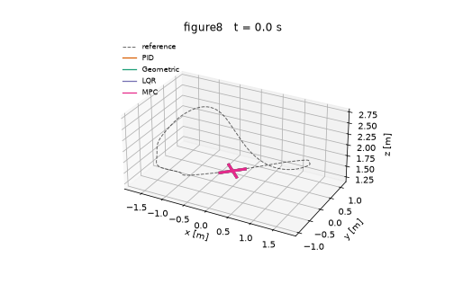
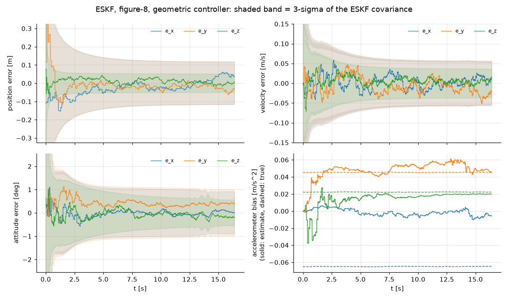
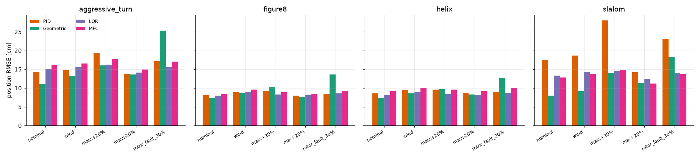
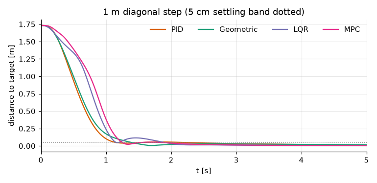
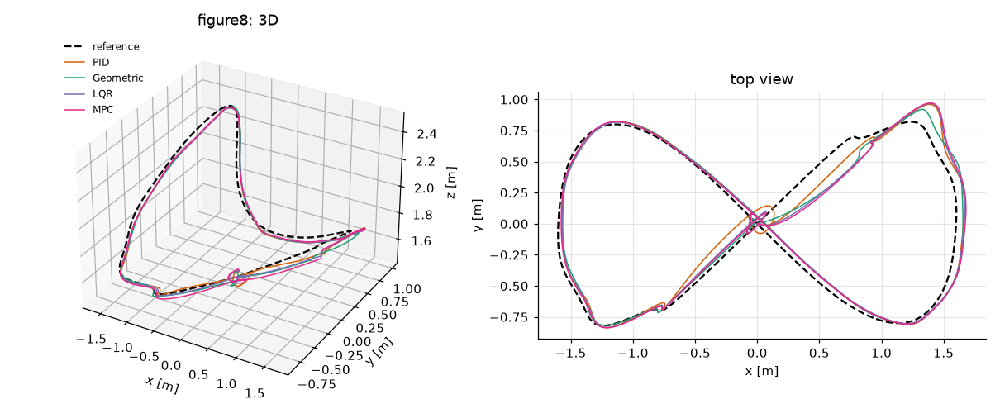
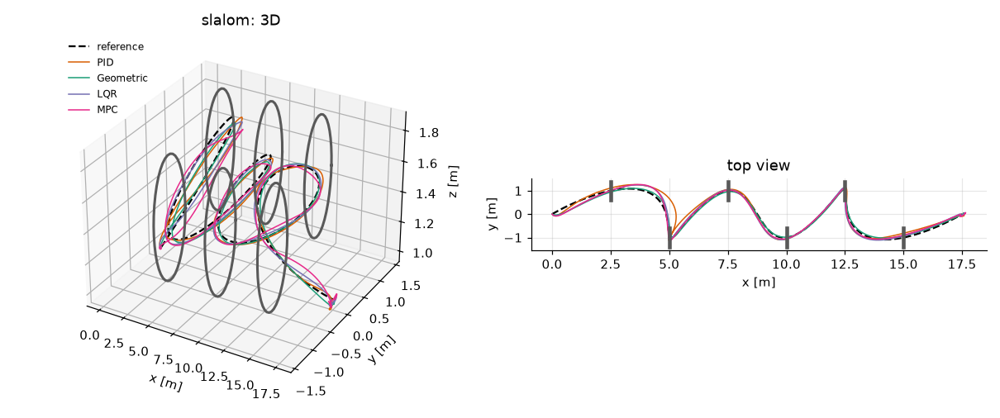
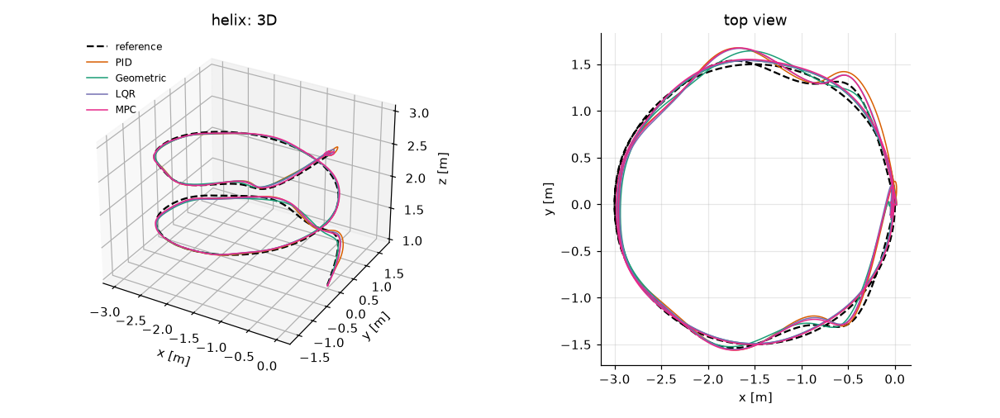
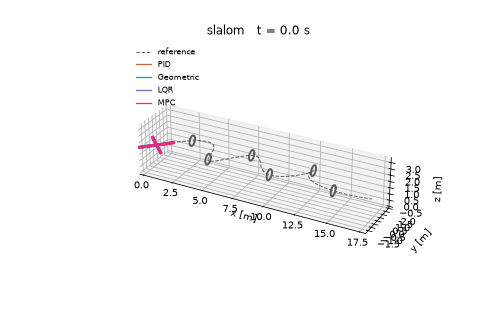
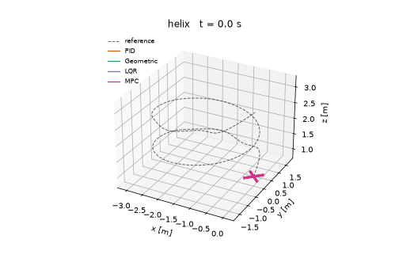

# quadrotor-control

Symulacja i sterowanie quadrocopterem napisane od zera w Pythonie 3.11+: dynamika 6-DOF
(Newton-Euler, kwaternion), cztery regulatory (kaskadowy PID, geometryczny SO(3), LQR, liniowe MPC),
trajektorie min-snap, symulowane sensory (IMU, GPS, barometr, magnetometr) i filtr ESKF,
na którego estymacie pracują wszystkie regulatory.



## Opis problemu

Quadrotor jest układem niedopełnionym (4 wejścia, 6 stopni swobody): pozycję zmienia się przez
pochylenie wektora ciągu, więc sterowanie ma strukturę kaskadową *pozycja → orientacja → prędkości
kątowe → obroty wirników*. Celem projektu jest porównanie czterech podejść do tego problemu na
tych samych scenariuszach, z tym samym estymatorem i przy tych samych zakłóceniach (wiatr, błąd
masy ±20 %, awaria wirnika), ze zwróceniem uwagi na poprawność fizyczną i matematyczną modelu.

## Kluczowe równania

Układ inercjalny: z w górę (ENU), układ ciała: x do przodu, y w lewo, z w górę.
Stan: pozycja `p`, prędkość `v` (inercjalne), kwaternion `q` (ciało → inercjalny),
prędkość kątowa `ω` (w układzie ciała), prędkości wirników `Ω_i`.

```
ṗ = v
m v̇ = R(q) e₃ · T  −  c_d (v − v_wiatr)  −  m g e₃,        T = Σ kf·Ω_i²
q̇ = ½ q ⊗ [0, ω]
J ω̇ = τ − ω × Jω,                                            τ = [ y_i f_i ,  −x_i f_i ,  ∓km Ω_i² ]ᵀ
Ω̇_i = (Ω_i,cmd − Ω_i) / τ_m,                                  Ω_i ∈ [Ω_min, Ω_max]
```

* Konfiguracja X, `f_i = kf Ω_i²`, moment reakcyjny `km Ω_i²` o znaku przeciwnym do kierunku obrotów.
* **Mikser** `[T, τ] = A f` (macierz alokacji 4×4, odwracalna) z odsprzęganiem nasycenia:
  najpierw minimalne przesunięcie ciągu, potem skalowanie momentów.
* **Integracja**: RK4, krok fizyki 1 kHz, sterowanie 250 Hz, EKF 100 Hz (IMU 500 Hz),
  renormalizacja kwaterniona po każdym kroku.
* **Wiatr**: średnia stała + porywy Ornsteina-Uhlenbecka (przybliżenie Drydena pierwszego rzędu).
* Wszystkie parametry fizyczne są w jednym miejscu: `configs/quad.yaml` / `quadrotor.params.QuadParams`.

Linearyzacja w zawisie (`T = mg`, stan `[p, v, φ, θ, ψ, ω]`): `δv̇ = [gθ, −gφ, δT/m] − (c_d/m) δv`,
`δω̇ = J⁻¹ δτ`, co jest podstawą LQR i MPC (`quadrotor.dynamics.linearize_hover`).

## Regulatory (`src/quadrotor/control/`)

| Regulator | Idea |
|---|---|
| **PID** (`pid.py`) | Kaskada: P pozycji → PID prędkości → wektor ciągu i żądana orientacja → P na kątach Eulera → PID prędkości kątowych (D na pomiarze, filtrowane). Anti-windup: obcięcie całki + całkowanie warunkowe (tylko blisko celu). Ograniczenie prędkości i kąta pochylenia. |
| **Geometryczny SO(3)** (`geometric.py`) | Lee, Leok, McClamroch (2010): `F = −kₓeₓ − k_v e_v − kᵢ∫eₓ + m(a_d + g e₃)`, `R_d = [b₁d b₂d b₃d]`, `b₃d = F/‖F‖`; `τ = −k_R e_R − k_Ω e_Ω + Ω×JΩ − J(Ω̂RᵀR_dΩ_d − RᵀR_dΩ̇_d)`, `e_R = ½ vee(R_dᵀR − RᵀR_d)`. Śledzi pozycję i yaw, działa dla dużych błędów orientacji. `Ω_d` wyliczane analitycznie z jerku (feed-forward), mała całka na `e_R` i pozycji. |
| **LQR** (`lqr.py`) | Pełny stan (12) + całka błędu pozycji (15 stanów) na modelu zlinearyzowanym w zawisie; feed-forward ciągu `m‖a_d + g e₃‖` i kąta z przyspieszenia zadanego. **Dobór Q, R regułą Bryson'a**: `Qᵢᵢ = 1/xᵢ,max²`, `Rᵢᵢ = 1/uᵢ,max²` – dopuszczalne odchyłki: 10 cm, 0,7 m/s, 8° (przechyły), 1 rad/s, całka 0,15 m·s; wejścia: 30 % ciągu zawisu, 0,4 N·m (przechył/pochylenie), 0,1 N·m (yaw). Wagi są więc skalowane fizycznie, a nie „na oko”. |
| **MPC** (`mpc.py`) | Liniowe MPC (cvxpy + OSQP) na tym samym modelu z całką, horyzont **20 kroków × 20 ms**, aktualizacja 50 Hz. Preview trajektorii, koszt Bryson'a + koszt końcowy z równania Riccatiego (DARE), ograniczenia: ciąg 2–24 N, momenty, kąty przechyłu/pochylenia ≤ 40° (miękkie, ze zmienną luzu, żeby QP było zawsze wykonalne). Przy niepowodzeniu solvera używany jest LQR. |

## Trajektorie (`src/quadrotor/planning/`)

Generator **min-snap** (Mellinger & Kumar 2011): wielomiany 7. rzędu (8 współczynników na segment)
niezależnie dla każdej osi, minimalizacja `∫ (d⁴p/dt⁴)² dt` przy ograniczeniach: interpolacja punktów
pośrednich oraz ciągłość prędkości, przyspieszenia i jerku (i zerowe pochodne na końcach). Problem
QP z ograniczeniami równościowymi jest rozwiązywany dokładnie z układu KKT (w czasie znormalizowanym
segmentu dla dobrego uwarunkowania). Generator zwraca `p, v, a, j, s` (feed-forward do regulatorów).

Scenariusze (`scenarios.py`): **ósemka 3D** (3,2 × 1,6 m, 1 m różnicy wysokości), **helisa**
(2 zwoje, promień 1,5 m), **slalom** przez 6 bramek (Ø 0,8 m), **agresywny zwrot** (~4,8 m/s,
nawrót o 180° z jednoczesną zmianą yaw o 90°). Czas trajektorii jest skalowany tak, aby
przyspieszenie poziome nie przekraczało 6–8 m/s².

## Estymacja (`src/quadrotor/estimation/`)

* **Sensory**: IMU 500 Hz (szum białego szumu + błąd błądzenia losowego biasu), GPS 10 Hz
  (pozycja σ = 0,3/0,3/0,5 m, prędkość σ = 0,05 m/s), barometr 50 Hz (σ = 0,15 m), magnetometr (kurs)
  25 Hz (σ = 0,03 rad) – ten ostatni dodałem, bo bez niego yaw jest nieobserwowalny.
* **ESKF** (15 stanów błędu: `δp, δv, δθ, δb_a, δb_g`, błąd orientacji w układzie ciała, forma Josepha,
  reset macierzy kowariancji po wstrzyknięciu błędu). Stan nominalny jest całkowany z częstotliwością IMU,
  kowariancja i poprawki – 100 Hz. Regulatory dostają `p, v, q` z filtra oraz gyro pomniejszone o estymowany bias.



## Wyniki

Pełny zestaw (`python scripts/run_all.py`): 4 scenariusze × 4 regulatory × 5 przypadków
+ wersje z idealnym stanem + odpowiedź skokowa. Surowe dane: [`results/metrics.csv`](results/metrics.csv).
Przypadki: `wind` – średni wiatr (4, −3, 0) m/s + porywy OU σ = 1,5 m/s; `mass±20%` – masa (i inercja)
obiektu różna od modelu regulatora; `rotor_fault_30%` – od t = 1 s wirnik nr 0 traci 30 % sprawności
(ciąg i moment). RMSE liczone względem prawdziwego (nie estymowanego) położenia.

<!-- RESULTS:START -->
#### Śledzenie trajektorii (estymata ESKF, bez zakłóceń)

| Scenariusz | Regulator | RMSE [m] | Błąd max [m] | Energia [J] | Chybienie bramki [m] |
|---|---|---|---|---|---|
| figure8 | PID | 0.0803 | 0.214 | 7344.4 |  |
| figure8 | Geometric | 0.0725 | 0.1998 | 7231.9 |  |
| figure8 | LQR | 0.0802 | 0.2108 | 7291.4 |  |
| figure8 | MPC | 0.0847 | 0.2443 | 7280.3 |  |
| helix | PID | 0.0855 | 0.2979 | 8341.0 |  |
| helix | Geometric | 0.0733 | 0.174 | 8188.7 |  |
| helix | LQR | 0.0815 | 0.2462 | 8333.2 |  |
| helix | MPC | 0.0918 | 0.2948 | 8339.3 |  |
| slalom | PID | 0.176 | 0.4615 | 5970.9 | 0.192 |
| slalom | Geometric | 0.0799 | 0.2056 | 5640.7 | 0.12 |
| slalom | LQR | 0.133 | 0.3139 | 5858.2 | 0.075 |
| slalom | MPC | 0.1282 | 0.3072 | 5861.6 | 0.11 |
| aggressive_turn | PID | 0.1435 | 0.2864 | 4256.4 |  |
| aggressive_turn | Geometric | 0.1103 | 0.212 | 3998.6 |  |
| aggressive_turn | LQR | 0.1502 | 0.3116 | 4255.5 |  |
| aggressive_turn | MPC | 0.1623 | 0.3238 | 4305.8 |  |

#### Śledzenie trajektorii z idealną informacją o stanie (bez EKF)

| Scenariusz | Regulator | RMSE [m] | Błąd max [m] | Energia [J] | Chybienie bramki [m] |
|---|---|---|---|---|---|
| figure8 | PID | 0.0511 | 0.172 | 7365.5 |  |
| figure8 | Geometric | 0.0247 | 0.0855 | 7240.4 |  |
| figure8 | LQR | 0.0385 | 0.1377 | 7307.8 |  |
| figure8 | MPC | 0.0463 | 0.1368 | 7296.4 |  |
| helix | PID | 0.0498 | 0.1838 | 8331.0 |  |
| helix | Geometric | 0.0243 | 0.0823 | 8195.8 |  |
| helix | LQR | 0.0458 | 0.1719 | 8328.7 |  |
| helix | MPC | 0.0591 | 0.1698 | 8330.7 |  |
| slalom | PID | 0.1364 | 0.2868 | 5881.9 | 0.143 |
| slalom | Geometric | 0.0296 | 0.0586 | 5607.0 | 0.033 |
| slalom | LQR | 0.11 | 0.1825 | 5799.3 | 0.139 |
| slalom | MPC | 0.1021 | 0.1805 | 5790.5 | 0.148 |
| aggressive_turn | PID | 0.1129 | 0.1839 | 4248.1 |  |
| aggressive_turn | Geometric | 0.0525 | 0.0968 | 3995.5 |  |
| aggressive_turn | LQR | 0.1224 | 0.2505 | 4252.3 |  |
| aggressive_turn | MPC | 0.1404 | 0.2777 | 4300.5 |  |

#### Odporność: RMSE śledzenia [m] (estymata ESKF)

| Scenariusz | Regulator | nominal | wind | mass+20% | mass-20% | rotor_fault_30% |
|---|---|---|---|---|---|---|
| figure8 | PID | 0.0803 | 0.0884 | 0.0914 | 0.0796 | 0.0849 |
| figure8 | Geometric | 0.0725 | 0.0873 | 0.1023 | 0.0766 | 0.1362 |
| figure8 | LQR | 0.0802 | 0.0897 | 0.0828 | 0.081 | 0.0859 |
| figure8 | MPC | 0.0847 | 0.0956 | 0.0885 | 0.0844 | 0.0928 |
| helix | PID | 0.0855 | 0.0951 | 0.0963 | 0.0869 | 0.0903 |
| helix | Geometric | 0.0733 | 0.0863 | 0.0973 | 0.0825 | 0.1268 |
| helix | LQR | 0.0815 | 0.09 | 0.0841 | 0.0822 | 0.0873 |
| helix | MPC | 0.0918 | 0.1 | 0.0956 | 0.0917 | 0.1003 |
| slalom | PID | 0.176 | 0.1869 | 0.2807 | 0.1423 | 0.2311 |
| slalom | Geometric | 0.0799 | 0.0916 | 0.1407 | 0.1143 | 0.1832 |
| slalom | LQR | 0.133 | 0.1428 | 0.1451 | 0.1237 | 0.1389 |
| slalom | MPC | 0.1282 | 0.137 | 0.1481 | 0.1119 | 0.1377 |
| aggressive_turn | PID | 0.1435 | 0.1469 | 0.1923 | 0.1368 | 0.1712 |
| aggressive_turn | Geometric | 0.1103 | 0.1324 | 0.1606 | 0.1358 | 0.2531 |
| aggressive_turn | LQR | 0.1502 | 0.156 | 0.1622 | 0.1415 | 0.1561 |
| aggressive_turn | MPC | 0.1623 | 0.1657 | 0.1773 | 0.1494 | 0.1703 |

#### Odpowiedź na skok 1 m (po przekątnej, stan idealny)

| Regulator | Czas ustalania (5 cm) [s] | Przeregulowanie [m] | Energia [J] |
|---|---|---|---|
| PID | 2.19 | 0.0 | 3527.4 |
| Geometric | 1.39 | 0.029 | 3518.3 |
| LQR | 1.89 | 0.09 | 3690.9 |
| MPC | 1.84 | 0.053 | 3658.0 |

<!-- RESULTS:END -->





**Wnioski.**

* Z idealnym stanem regulator geometryczny jest najdokładniejszy (RMSE 2–5 cm), bo pracuje na pełnym
  modelu nieliniowym i używa feed-forwardu jerku. LQR/MPC bazują na linearyzacji w zawisie, więc
  degradują się na agresywnych trajektoriach (duże kąty), a PID ma największy błąd na slalomie.
* Z estymatą ESKF RMSE wszystkich regulatorów rośnie do 7–18 cm – dominuje błąd estymacji
  (GPS σ = 0,3 m), a różnice między regulatorami maleją.
* Błąd masy ±20 % jest kompensowany przez człony całkujące (LQR/MPC najlepiej, bo całka jest częścią modelu).
* Awaria wirnika (−30 %) najbardziej szkodzi regulatorowi geometrycznemu (całka tylko na `e_R` z małym
  wzmocnieniem, moment zakłócający jest stały), LQR/MPC z całką pozycji radzą sobie lepiej.
* MPC jest praktycznie równoważne LQR w warunkach bez aktywnych ograniczeń; ich zaletą są twarde limity
  (test `test_mpc_tracks_and_respects_tilt_limit`), kosztem ~2× dłuższego czasu symulacji.

### Wykresy i animacje

| ósemka | slalom | helisa |
|---|---|---|
|  |  |  |




Błąd śledzenia w czasie: `results/error_*.png`; trajektorie agresywnego zwrotu: `results/trajectory_aggressive_turn.png`.

## Uruchomienie

```bash
pip install -e ".[dev]"        # numpy, scipy, matplotlib, pillow, pyyaml, cvxpy, pytest, ruff
python scripts/run_all.py      # wszystkie eksperymenty, wykresy, GIF-y, tabele (≈5 min, 4 rdzenie CPU)
python scripts/run_all.py --quick      # test dymny (≈30 s)
python scripts/make_animations.py      # tylko GIF-y
pytest -q                      # testy (≈25 s)
ruff check . && ruff format --check .
```

## Testy (`tests/`)

Zachowanie energii bez tarcia i sterowania (RK4, człon żyroskopowy), norma kwaterniona, zawis w równowadze
(`T = mg`), saturacja i dynamika silnika, odwracalność miksera, zgodność linearyzacji z modelem nieliniowym
(błąd drugiego rzędu; test na modelu z kwaternionem), zbieżność regulatora geometrycznego (także od
odwróconej orientacji 120° i dla yaw), ciągłość pochodnych i optymalność min-snap (perturbacje w
przestrzeni zerowej ograniczeń, rozwiązanie analityczne dla dwóch punktów), spójność ESKF (błędy w
granicach 3σ, zbieżność biasów), LQR (stabilność, integracja przy błędzie masy), MPC (ograniczenia).
CI (GitHub Actions): `ruff` + `pytest` + test dymny pipeline'u na Pythonie 3.11 i 3.12.

## Znane ograniczenia

* Opór aerodynamiczny jest liniowy (bez oporu wirników i efektów blade-flapping), pominięty moment
  żyroskopowy wirników i efekt przyziemienia.
* LQR/MPC wykorzystują linearyzację w zawisie; przy dużych kątach (agresywny zwrot) są mniej dokładne
  niż regulator geometryczny. W regulatorze geometrycznym pominięto `Ω̇_d` (przyspieszenie kątowe zadane).
* MPC działa 50 Hz z podtrzymaniem zerowego rzędu, horyzont 20 kroków (0,4 s); nie ma modelu wirników
  ani opóźnień. Wagi i wzmocnienia strojono ręcznie, nie automatycznie.
* Wyniki pochodzą z jednego ziarna losowego szumu sensorów; różnice rzędu 1 cm między regulatorami z ESKF
  nie są istotne statystycznie. Wiatr o małym oporze (`c_d = 0,15 N·s/m`) wpływa na wyniki umiarkowanie.
* Awaria wirnika: regulatory nie mają reguł rekonfiguracji (brak detekcji awarii) – poradzą sobie tylko
  dzięki członom całkującym i zapasowi ciągu.
* ESKF wykorzystuje dodatkowo magnetometr (kurs); bez niego yaw dryfuje.

## Co dalej

* SLAM/odometria wizyjna zamiast GPS (lot w pomieszczeniach), fuzja z lidarem/kamerą.
* Uczenie ze wzmocnieniem (PPO/SAC) jako regulator niskiego poziomu lub adaptacja wzmocnień, porównanie
  z geometrycznym w tym samym środowisku.
* Model 3D w Gazebo / Isaac Sim, interfejs ROS 2 i PX4 SITL.
* Nieliniowe MPC (acados/CasADi) uwzględniające pełną dynamikę oraz rekonfigurację po awarii wirnika (FTC).
* Estymacja wiatru (obserwator zakłóceń) i planowanie trajektorii uwzględniające ograniczenia rotorów.

## Struktura

```
configs/quad.yaml        parametry fizyczne
src/quadrotor/           params, rotations, dynamics, wind, sim, experiments, plotting
  control/               pid, geometric, lqr, mpc (+ linear_common, base)
  planning/              minsnap, scenarios
  estimation/            sensors, eskf, pipeline
scripts/                 run_all.py, make_animations.py
tests/                   pytest
results/                 wykresy, GIF-y, metrics.csv, metrics.md
```

## Literatura

* T. Lee, M. Leok, N. H. McClamroch, *Geometric tracking control of a quadrotor UAV on SE(3)*, CDC 2010.
* D. Mellinger, V. Kumar, *Minimum snap trajectory generation and control for quadrotors*, ICRA 2011.
* J. Solà, *Quaternion kinematics for the error-state Kalman filter*, 2017.
